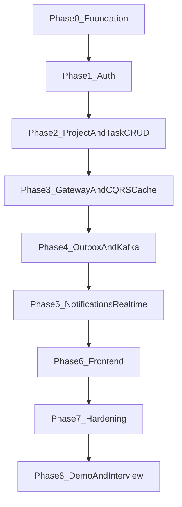

# FlowDesk — End-to-End Build Phases

This is the implementation sequence after the FRD, system design, and database
design exist. Each phase has one demoable outcome and must close in one or more
10PM–2AM sessions. Do not start the next phase until the gate is green.

Rule that never bends: **plain working CRUD first, then one pattern at a time.**
Kafka, Outbox, CQRS cache, Redis Pub/Sub, and Circuit Breaker are not Week 1
work.

Related docs:

- [frd.md](frd.md)
- [system-design.md](system-design.md)
- [database-design.md](database-design.md)
- [requirements.md](requirements.md)
- [session-zero.md](session-zero.md)

---

## Current state (as of this document)

**Done**

- Git monorepo + parent POM (Spring Boot 4.1.0, Cloud 2025.1.2)
- Service shells with `*Application.java` and ports
- ArchUnit, Spotless, Checkstyle, `mvn verify` green
- Infra compose (Postgres, Redis, Mongo, Kafka, Zookeeper, Eureka)
- Root CI: backend `mvn verify`
- Design docs: FRD, system design, database design

**Not done**

- Business logic (entities, APIs, JWT, outbox, consumers)
- ADR-000 Decision/Consequences still blank
- Frontend (`package.json` / `src/` missing)
- CI frontend job

---

## Phase map



| Phase | Name | Sessions (est.) | Demo gate |
|---|---|---|---|
| 0 | Foundation close-out | 1 | ADR-000 written; compose healthy; docs owned |
| 1 | Auth | 2–3 | Register → JWT → protected endpoint |
| 2 | Project + Task CRUD | 3–4 | Project + members + tasks; 409 on stale version |
| 3 | Gateway + CQRS cache | 2–3 | All traffic via 8080; Redis cache hit |
| 4 | Outbox + Kafka + Analytics | 2–3 | Create task → outbox → Kafka → metrics |
| 5 | Notifications + WebSocket | 2–3 | Two tabs: update in one, notify in the other |
| 6 | Frontend | 3–4 | Full browser flow without Postman |
| 7 | Hardening + observability | 2 | Kill notification service; CRUD still works |
| 8 | Polish + interview pack | 2 | Clone, compose up, 3-min whiteboard from memory |

Stretch (after Phase 8 only): WhatsApp fallback, Elasticsearch, Debezium, AI summary.

---

## Phase 0 — Foundation close-out

**Goal:** Own the design before writing feature code.

**Do**

- Edit [frd.md](frd.md) / [requirements.md](requirements.md) in your own words (numbers you will defend)
- Fill [adr/ADR-000-why-microservices.md](adr/ADR-000-why-microservices.md) Decision + Consequences honestly (portfolio value, not fake scale)
- `docker-compose up -d` and confirm Postgres, Redis, Mongo, Kafka, Eureka
- Optional: rename `application.yaml` → `application.yml` for consistency

**Do not**

- Write JWT, entities, or controllers yet

**Gate**

- [ ] ADR-000 is yours, not a blank template
- [ ] Infra is up
- [ ] You can explain FR-TASK-12 (event must survive crash) without looking at Kafka docs

**Maps to:** NFR-MAINT-02, Gate 0 from the mentor rule

---

## Phase 1 — Auth Service (dumbest version that works)

**Goal:** Identity exists. Other services can trust a JWT later.

**Do (in order)**

1. Flyway/Liquibase: `users`, `refresh_tokens` ([database-design.md](database-design.md) §4.1)
2. Register + login (email/password, bcrypt/argon2)
3. Access JWT (≤15 min) + refresh token stored hashed
4. Refresh rotation; reuse of old refresh → reject
5. Logout revokes refresh token
6. Correlation ID on auth request logs

**Defer to later in this phase or Phase 3**

- Google OAuth (FR-AUTH-07) — add only after email/password is solid
- Gateway JWT filter — Auth can issue tokens first; Gateway validates in Phase 3

**Tests**

- Unit: password never logged/returned
- Unit: rotated refresh cannot be reused
- Postman: register → login → refresh → logout

**Failure-mode**

- Kill Postgres: register/login fail loudly (expected). No silent “success”.

**Gate**

```text
POST /auth/register → 201
POST /auth/login    → access + refresh
GET  protected ping with Bearer → 200
```

**Maps to:** FR-AUTH-01..06, NFR-SEC-01..02

---

## Phase 2 — Project + Task CRUD (no Kafka)

**Goal:** The product exists as REST + Postgres. Optimistic lock works.

### 2a Project Service

- Tables: `projects`, `project_members`
- Create project → creator is Owner
- Add/remove members; Owner-only role change; Admin cannot remove Owner
- Server-side RBAC (AOP `@RequiresRole` is fine *after* one endpoint has an explicit check)

### 2b Task Service — command + query as plain services, same DB

- Tables: `tasks` (with `version`), then comments/labels if time
- Create / update / list by project+status / archive
- `@Version` → 409 Conflict on stale write
- **No** Outbox, **no** Kafka, **no** `@Cacheable` yet

**Tests**

- Optimistic lock conflict path (two updates, second 409)
- Member cannot hit Owner-only project mutation

**Failure-mode**

- Kill Postgres: writes fail. Document it.

**Gate**

- Create project, add member, create 10 tasks
- Concurrent update returns 409 and UI-contract error body
- Kanban list query works: `GET tasks?projectId=&status=`

**Maps to:** FR-PROJ-*, FR-TASK-01..10, NFR-CONS-01, NFR-SEC-03

---

## Phase 3 — API Gateway + CQRS split + Redis cache

**Goal:** One public port. Reads are fast. Writes still do not talk to Kafka.

**Do**

1. Eureka registration for all services (if not already)
2. Gateway routes `lb://auth-service` etc. on port **8080**
3. Gateway: JWT validation, correlation ID filter, Redis rate limit (100 req/min → 429)
4. Split Task into `TaskCommandService` + `TaskQueryService` (separate classes)
5. `@Cacheable` on query; `@CacheEvict` on command
6. Remove duplicate JWT filters from services *after* Gateway is proven (services may still check roles)

**Three questions before Redis cache (answer in your own words)**

1. What breaks without cache? (Kanban poll latency under many clients)
2. What does it cost? (stale reads if eviction is wrong)
3. When rip it out? (tiny dataset, single instance, eviction bugs)

**Failure-mode**

- Kill Redis: reads fall back to DB (must still work). Rate limit may fail-open or fail-closed — pick one and document it.

**Gate**

- All APIs reachable only via 8080
- `redis-cli` shows a task-list cache key after a GET
- After PATCH task, next GET is a miss then refill

**Maps to:** FR-X-01, FR-X-02, FR-TASK-09, NFR-PERF-02, NFR-SEC-04

---

## Phase 4 — Outbox + Kafka + Analytics

**Goal:** Task writes stay correct if Kafka is down. Analytics is a consumer, not a callback.

**Do**

1. `task_outbox` in the **same** DB and **same** `@Transactional` as the task write
2. `OutboxPoller` every ~1s: PENDING → Kafka → PUBLISHED
3. Topics: `task.created`, `task.status.changed`, `task.assigned` (plus later comment if needed)
4. Analytics Service: consume events, upsert `project_metrics_daily` / velocity snapshots
5. Analytics reads from replica **or** its own tables — never hammer task primary for dashboards

**Chaos test (required)**

- Stop Kafka → create tasks → rows in outbox PENDING → start Kafka → events publish
- Kill Task Service mid-poll: no lost domain event (NFR-DUR-01)

**Do not** wire Notification Service yet.

**Gate**

- Task create returns 201 before analytics updates
- Analytics count moves without Task Service calling it
- Duplicate poll does not double-publish in a harmful way (idempotent event id)

**Maps to:** FR-TASK-11..12, FR-AN-01..04, NFR-DUR-01, NFR-AV-02

**ADR:** ADR-004 Outbox, ADR-002 sync vs async, ADR-005 CQRS (if not written)

---

## Phase 5 — Notification Service + WebSocket fanout

**Goal:** Side effect is durable and real-time across instances.

**Do**

1. Kafka consumer + MongoDB persist (`notifications` collection, TTL 30 days)
2. Idempotency: Redis SET `processed_event:{eventId}`
3. STOMP/SockJS WebSocket
4. Redis Pub/Sub `flowdesk:notif:{projectId}` so **all** instances push local sockets
5. REST: list, mark read, unread count
6. Resilience4j on any sync call (e.g. member lookup) — fallback must not lose the Kafka offset incorrectly

**Chaos test**

- Two notification instances; user on instance B still gets push
- Kill Notification Service: task CRUD still 201; events wait in Kafka
- Replay same event: no duplicate notification (unique eventId+recipient)

**Gate**

- Two browser tabs (or two WS clients): update task in A, bell in B
- Mongo document exists; unread count API matches

**Maps to:** FR-NOTIF-*, FR-UI-06 (backend ready), NFR-PERF-03, NFR-SCALE-03, NFR-DUR-02

**ADR:** ADR-003 WebSocket fanout, ADR-001 CAP/polyglot

---

## Phase 6 — Frontend

**Goal:** The product is usable without Postman.

**Do**

1. Scaffold `FlowDesk-Frontend/` (`package.json`, `src/`)
2. Auth pages + axios interceptor (refresh on 401)
3. Redux: auth + notification count; React Query: server lists
4. Projects dashboard
5. Kanban + drag-and-drop status PATCH
6. `useWebSocket` → update board + bell
7. 409 handling: “Task changed — refresh and retry”
8. Add npm install/build/lint job to [`.github/workflows/ci.yml`](../../.github/workflows/ci.yml)

**Gate**

- Register → create project → add tasks → drag card → other tab updates
- Expired access token refreshes silently

**Maps to:** FR-UI-01..08

---

## Phase 7 — Hardening + observability

**Goal:** You can operate and explain the system when something dies.

**Do**

- Zipkin: one correlation ID across Gateway → Task → (async: event id in payload)
- Prometheus + Grafana: latency, error rate, consumer lag
- OpenAPI/Swagger per service
- Circuit-breaker demo: Notification down, Task still writes
- Error-body consistency (`ApiResponse` in common-lib)

**Gate**

- Kill Notification: task create works; circuit opens; metrics show it
- Zipkin shows the sync chain for PATCH task
- `mvn verify` + frontend build green in CI

**Maps to:** NFR-OBS-*, NFR-TEST-*, FR-X-03..04

---

## Phase 8 — Polish + interview pack

**Goal:** Someone else can run it; you can whiteboard it cold.

**Do**

- ADR-001..005 complete in `docs/adr/`
- README: architecture diagram, setup, **SD concepts index** (concept → file)
- One-command `docker-compose` for full stack
- 3-minute demo script: “user updates a task” left-to-right from memory
- For ≥5 patterns: a case where you would **not** use them

**Gate**

- Clone + compose → working system
- Whiteboard the data flow in under 3 minutes with no notes
- You can answer: what breaks without Outbox / what it costs / when to rip it out

---

## Per-phase definition of done (copy this)

- [ ] Demoable in Postman or browser (not only unit tests)
- [ ] Write-path unit test: happy path + one failure
- [ ] ArchUnit + Spotless + Checkstyle + CI green
- [ ] Kill the new dependency; write down degrade vs silent break
- [ ] Correlation ID on new request paths
- [ ] You can explain the new pattern without the code
- [ ] ADR if a new store or broker was introduced

---

## Explicit sequencing rules

| If you are tempted to… | Do this instead |
|---|---|
| Add Kafka in Phase 1 | Finish JWT first |
| Add WebSocket before Mongo persist | Persist first, then push |
| Add Gateway before any service works | Get Auth + one CRUD service on its own port first |
| Add OAuth, search, AI, Debezium | After Phase 8 gate |
| Split CQRS folders with no tests | Split classes only after CRUD tests exist |

---

## Suggested calendar (fits 10PM–2AM)

Assume ~2 sessions per week of real focus:

| Week | Phase |
|---|---|
| Session Zero (done-ish) | Phase 0 remaining: ADR-000 |
| Week 1 | Phase 1 |
| Week 2 | Phase 2 |
| Week 3 | Phase 3 |
| Week 4 | Phase 4 |
| Week 5 | Phase 5 |
| Week 6 | Phase 6 |
| Week 7 | Phase 7 |
| Week 8 | Phase 8 |

If a phase slips, **cut comments/labels/OAuth**, not optimistic locking or outbox atomicity.
