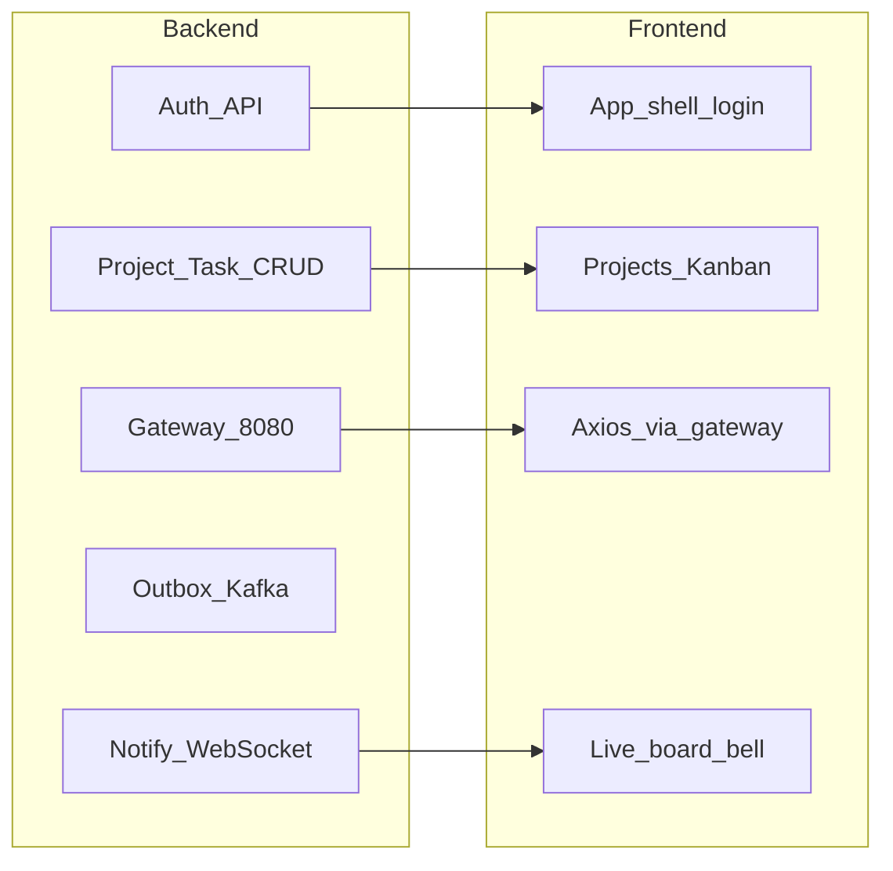

# FlowDesk — Frontend + Backend End-to-End Timeline

One product, two tracks. Backend unlocks APIs; frontend consumes them the
**same week they become demoable**, not all dumped into week 6.

Constraint: each week is ~5 nights × 4 hours (10PM–2AM). If a week slips, cut
scope on that week’s **UI polish**, never optimistic locking or outbox
atomicity.

Related: [build-phases.md](build-phases.md) · [frd.md](frd.md) · [system-design.md](system-design.md)

---

## How the two tracks depend on each other

Frontend never blocks backend. If UI is behind, keep shipping Postman-tested
APIs. If backend is behind, frontend stays on mock/fixture for that screen only.

---

## 8-week calendar (both sides)

| Week | Backend (what you build) | Frontend (what you build) | Joint demo Friday |
|---|---|---|---|
| **0** (done / leftover) | Scaffold, compose, FRD/SD/DB docs | Placeholder only | `mvn verify` green |
| **1** | Auth: register, login, JWT, refresh rotation, logout | Scaffold app: Vite/React, router, login+register forms, token storage | Browser login against Auth **or** Postman JWT if UI slips |
| **2** | Project CRUD + members + RBAC. Task CRUD + `@Version` 409. **No Kafka** | Auth interceptor. Projects list/create. Kanban columns from REST (no DnD required) | Create project + tasks in UI **or** Postman; 409 visible in Network tab |
| **3** | Gateway 8080, JWT filter, rate limit, Task CQRS + Redis cache | Point axios `baseURL` to gateway only. Handle 429. Loading/error states | Entire UI talks to `:8080` only |
| **4** | Outbox + Kafka + Analytics consumer/read APIs | Analytics page (velocity/completion) — can be ugly table | Create task in UI → analytics number moves (eventual) |
| **5** | Notification persist + WS + Redis fanout + unread API | `useWebSocket`, bell, unread badge, history drawer | Two tabs: drag/status in A, bell in B |
| **6** | Freeze new backend features. Bugfix APIs the UI hits | DnD Kanban, 409 “refresh and retry”, polish dashboard, empty states | Full happy path with **no Postman** |
| **7** | Zipkin, Prometheus, Grafana, circuit-breaker demo, OpenAPI | Correlation ID in axios headers (already from gateway). Don’t build a metrics UI | Kill notification service; create task still works; trace in Zipkin |
| **8** | ADRs 001–005, compose full stack, README concept index | README screenshots, 3-min click-through script | Clone → `compose up` → register → board → live notify |

**Stretch (after week 8):** OAuth Google UI, WhatsApp, search, Debezium, AI summary.

---

## Week-by-week detail

### Week 0 — Foundation (mostly done)

| Backend | Frontend |
|---|---|
| Parent POM, 7 modules, ArchUnit, compose, CI `mvn verify` | `FlowDesk-Frontend/` still empty |
| Fill ADR-000 yourself | — |

**You are here** except ADR-000 Decision is still blank.

### Week 1 — Identity

| Backend | Frontend |
|---|---|
| `users` + `refresh_tokens` | `npm create` React+Vite, ESLint |
| `POST /auth/register`, `/login`, `/refresh`, `/logout` | Login + register pages, client-side validation |
| Hashed passwords, short-lived access JWT | Save access+refresh (memory + httpOnly later if you add a BFF; for MVP localStorage is OK if you can explain the risk) |

**Friday gate:** one user exists; UI or Postman holds a valid JWT.

**Do not:** Gateway, Kafka, Google OAuth (unless login is already boring).

### Week 2 — Core product (CRUD)

| Backend | Frontend |
|---|---|
| Projects + members + server RBAC | Projects dashboard (list/create) |
| Tasks: create, update, list by status, `version` | Board: three columns fed by `GET .../tasks?status=` |
| Global 409 body for optimistic lock | Show raw error on stale update (pretty copy can wait until week 6) |

**Friday gate:** 10 tasks in a project; second concurrent save returns 409.

**Do not:** Outbox, WebSocket, cache.

### Week 3 — One door + faster reads

| Backend | Frontend |
|---|---|
| Eureka + Gateway routes | `VITE_API_URL=http://localhost:8080` |
| JWT + correlation ID + Redis 429 | Axios instance; refresh-on-401 interceptor |
| `TaskCommandService` / `TaskQueryService` + `@Cacheable` | Disable any leftover direct `:8081/:8083` URLs |

**Friday gate:** browser never calls a service port; Redis shows a cache key after board load.

### Week 4 — Events (backend-heavy)

| Backend | Frontend |
|---|---|
| Task + outbox same transaction; poller → Kafka | Analytics screen: read-only metrics API |
| Analytics consumes same topics | Skeleton chart or table is enough |

**Friday gate:** stop Kafka, create task (201), start Kafka, analytics updates.

Frontend this week is thin on purpose — Kafka chaos testing eats the 4-hour block.

### Week 5 — Real-time (both tracks)

| Backend | Frontend |
|---|---|
| Mongo notifications, idempotent consumer | STOMP client / `useWebSocket` |
| Redis Pub/Sub fanout, `/queue/notifications` | Bell + unread count + list |
| Mark-read + history APIs | Optional: live column move without refresh |

**Friday gate:** two browser sessions, one user or two members, live bell.

### Week 6 — Frontend finish line

| Backend | Frontend |
|---|---|
| Only fix contract bugs UI finds | `@dnd-kit` status PATCH |
| | 409 modal: refresh and retry |
| | Notification history, empty/loading/error |
| | CI: `npm ci && npm run lint && npm run build` in root workflow |

**Friday gate:** register → project → drag card → other tab updates. No Postman.

### Week 7 — Operate it

| Backend | Frontend |
|---|---|
| Zipkin, Prometheus, Grafana, Resilience4j demo | Send `X-Correlation-ID` if gateway doesn’t inject on WS |
| OpenAPI for the five services | No new features |

**Friday gate:** notification process killed; task create still 201; Zipkin shows PATCH chain.

### Week 8 — Ship the story

| Backend | Frontend |
|---|---|
| ADR-001–005, compose includes apps | Demo script + screenshots in README |
| SD concept → file index in README | Same README, one clone path |

**Friday gate:** cold whiteboard of “user updates a task” in under 3 minutes.

---

## Suggested split inside a 4-hour night

When a week has **both** tracks:

| Time | Focus |
|---|---|
| 10:00–12:00 | Backend (tests + API) |
| 12:00–12:20 | Break / `mvn verify` |
| 12:20–1:40 | Frontend wired to **today’s** API only |
| 1:40–2:00 | Joint demo + note the failure-mode test |

If backend is not callable by midnight, **do not start UI**. Finish the API.
If API is done at 11:30, spend the rest on frontend — that is the point of this timeline.

---

## What “done” means each week (both sides)

- Backend: Postman or test + ArchUnit/CI green + kill-the-new-dependency note
- Frontend: screen works against **this week’s** real API (or explicitly labeled mock)
- Joint: one sentence in a running `PROGRESS.md` or commit message: what a user can do now that they could not last week

---

## Cut list if you run out of time

Drop in this order (keep correctness):

1. Google OAuth UI and API
2. Labels / comments UI (keep API if already written)
3. Pretty analytics charts (keep JSON endpoint)
4. Drag-and-drop (status change via dropdown is enough for demo)
5. Grafana polish (Zipkin + actuator is enough)

Never drop: password hashing, 409 on stale task, outbox atomicity, notification idempotency.
