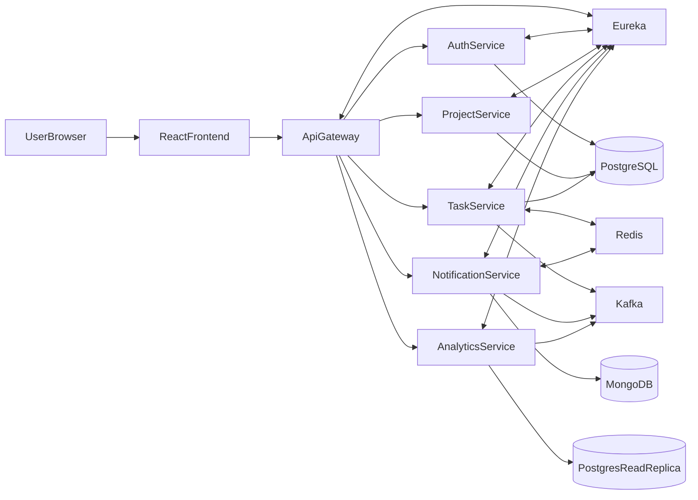
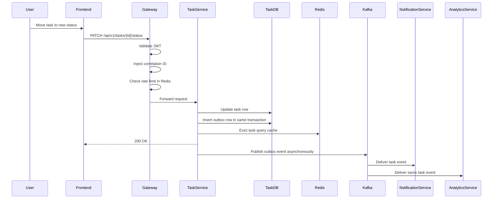
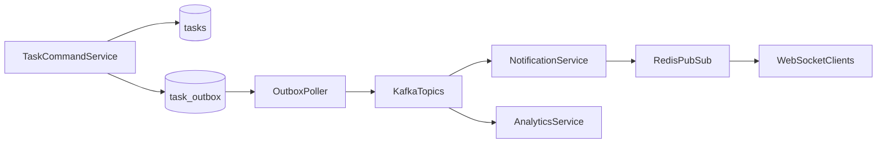

# FlowDesk - System Design

## 1. Overview

FlowDesk is a real-time collaborative project management platform implemented as
a backend microservice system behind a single gateway and a web frontend.

The architecture is designed around one central principle: core transactional
operations must remain correct even when side effects are delayed or degraded.
That principle drives the split between synchronous CRUD paths and asynchronous
event-driven side effects.

## 2. Goals and Constraints

### 2.1 Primary goals

- Provide a single place for teams to manage projects and tasks
- Deliver live task and notification updates without browser refresh
- Preserve correctness for project, task, and auth state
- Demonstrate production-grade distributed-system patterns in an interview-defensible way

### 2.2 Constraints

- Must be buildable by one engineer over roughly 8 weeks
- Must run well enough on a developer laptop for demos
- Must support horizontal scaling without redesigning core flows
- Must keep side effects decoupled from the task write path

## 3. High-Level Architecture

### 3.1 Logical components

- Frontend: React application for authentication, dashboard, Kanban, and notifications
- API Gateway: single ingress for routing, JWT validation, correlation ID, and rate limiting
- Auth Service: identity, token issuance, refresh-token rotation, and OAuth login
- Project Service: projects, membership, and role-based access rules
- Task Service: task write path, query path, cache invalidation, and outbox generation
- Notification Service: event consumption, notification persistence, and real-time push
- Analytics Service: event consumption and read-optimized project metrics
- Shared infra: PostgreSQL, Redis, MongoDB, Kafka, Zookeeper, Eureka, and observability stack

### 3.2 Architecture diagram

## 4. Service Responsibilities

### 4.1 API Gateway

Responsibilities:

- expose a single public API entry point
- validate JWTs before forwarding requests
- inject correlation IDs
- enforce per-user rate limits using Redis
- route requests using service discovery

Why it earns its cost:

- centralizes cross-cutting concerns
- keeps backend services stateless and focused
- provides one place to apply routing and protection policies

What it costs:

- one more network hop
- another service that can fail or misroute traffic
- tighter need for observability because every request passes through it

### 4.2 Auth Service

Responsibilities:

- register users
- authenticate users
- issue and refresh JWTs
- rotate refresh tokens
- support Google OAuth login

Why separate it:

- avoids auth logic duplication across services
- makes JWT validation a stable contract for the rest of the platform

### 4.3 Project Service

Responsibilities:

- create and update projects
- manage membership
- enforce owner/admin/member rules

Why AOP is justified here:

- project role checks are cross-cutting and repeated across mutating endpoints
- an aspect reduces duplicated controller/service logic

### 4.4 Task Service

Responsibilities:

- own transactional task data
- execute command-side mutations
- serve query-side task reads
- maintain read cache invalidation
- write outbox records for downstream side effects

Why Task Service is the core:

- it owns the system's most correctness-sensitive data
- it is the producer of the events that drive notifications and analytics

### 4.5 Notification Service

Responsibilities:

- consume task events
- persist user notifications
- push notifications to connected clients
- relay fanout across multiple service instances
- deduplicate broker re-delivery

Why it is asynchronous:

- notification creation is a side effect, not part of the user's transactional success condition
- task updates should succeed even if notification delivery is delayed

### 4.6 Analytics Service

Responsibilities:

- consume the same task event stream independently
- aggregate and store read-oriented metrics
- serve project analytics without touching the primary write path

Why separate it:

- analytical reads have different query patterns from transactional writes
- aggregation work should not slow task mutation

## 5. Communication Model

### 5.1 Synchronous paths

Use REST for operations where the caller needs an immediate result:

- login and refresh
- create or update project
- create or update task
- fetch tasks, projects, members, and analytics

### 5.2 Asynchronous paths

Use Kafka for side effects where the caller should not wait:

- notification generation
- analytics updates
- future search indexing or external integrations

### 5.3 Why this split is right for FlowDesk

Without async side effects, Task Service would need direct runtime knowledge of
Notification Service and Analytics Service. That would make task writes slower,
more fragile, and more tightly coupled.

The async model costs:

- eventual consistency
- idempotency work in consumers
- operating Kafka and outbox logic

It is still worth it here because task creation or update should not fail only
because analytics or notification handling is temporarily unhealthy.

## 6. Core Request Flow

### 6.1 Task status update flow

### 6.2 Why the user-facing write returns before side effects finish

The user cares first that the task update is accepted and durably stored.
Notification fanout and analytics updates are secondary concerns. Returning
after the primary transaction keeps the system responsive and isolates
non-critical latency from the write path.

## 7. Event Flow

### 7.1 Outbox to consumers

### 7.2 Why Outbox is necessary

Without outbox:

- app writes task to PostgreSQL
- app tries to publish to Kafka
- process crashes between the two
- task exists but no event exists
- notifications and analytics silently miss the change

With outbox:

- task row and outbox row commit atomically
- a poller can publish later after restart
- consumers must handle duplicates, but the event is not lost

This is exactly the kind of trade-off that earns complexity in FlowDesk.

## 8. Data Consistency Model

### 8.1 Strong consistency domains

Auth, Project, and Task are user-facing correctness domains:

- wrong task status is a product bug
- wrong project role is a security bug
- wrong token state is an auth bug

These services require strongly consistent transactional storage.

### 8.2 Eventually consistent domains

Notifications and analytics can lag briefly:

- a notification arriving a few hundred milliseconds later is acceptable
- analytics not reflecting the latest task update instantly is acceptable

The system makes this trade explicitly so the core write path stays correct and fast.

## 9. Scaling Strategy

### 9.1 Stateless services

All backend services are designed to scale horizontally:

- JWT avoids server-side session affinity
- Redis holds shared cache, counters, and dedup state
- Kafka partitions distribute event consumption
- Eureka and Gateway support service discovery and load balancing

### 9.2 Cache strategy

Task reads are cacheable because Kanban views repeatedly request similar task
lists. Query responses are cached in Redis and invalidated on writes.

Why cache only on the query side:

- reads and writes have different performance goals
- cache invalidation stays tied to write-side mutations
- command logic remains focused on correctness

### 9.3 WebSocket fanout strategy

When notification-service runs multiple instances, a Kafka event consumed by one
instance cannot directly reach users connected to another instance. Redis
Pub/Sub acts as the relay so all instances receive the fanout signal and push
to their own connected clients.

This avoids sticky sessions and preserves horizontal scale.

## 10. Reliability Patterns

### 10.1 Optimistic locking

Task updates use a version column so stale concurrent writes fail cleanly with a
conflict response rather than overwriting each other.

### 10.2 Idempotent consumers

Kafka gives at-least-once delivery, not exactly-once business effects.
Notification and analytics consumers must deduplicate repeated events.

### 10.3 Circuit breaking

Resilience4j is used on inter-service or external dependencies where repeated
failures should trip open rather than cascade latency and errors across the system.

### 10.4 Graceful degradation

Core task CRUD should remain available if:

- Notification Service is down
- Analytics Service is behind
- Kafka is temporarily unavailable for side effects

The main write path remains correct because the outbox stores pending work.

## 11. Security Design

- JWT-based stateless authentication
- refresh token rotation
- role-based access control at project boundaries
- gateway-side rate limiting
- server-side authorization on all mutating operations
- no cross-service trust based only on the frontend hiding actions

## 12. Observability Design

- correlation IDs injected at the gateway
- structured logs in every service
- health endpoints for liveness/readiness
- Prometheus metrics for latency, throughput, and failures
- Zipkin tracing for request path visibility

This is necessary because once side effects move async, logs alone are not
enough to explain end-to-end behavior.

## 13. Deployment Topology

### 13.1 Runtime topology

- one React frontend
- one API Gateway cluster
- five backend service clusters
- PostgreSQL for transactional domains
- a PostgreSQL read replica for analytics reads
- MongoDB for notifications
- Redis for cache, Pub/Sub, idempotency keys, and rate-limit counters
- Kafka plus Zookeeper for event streaming
- Eureka for discovery

### 13.2 Development topology

All infrastructure should be reproducible through Docker Compose for local
development and demos.

## 14. Key Trade-Offs

### 14.1 Why microservices at all

This architecture is not justified by real production traffic today; it is
justified by the learning and interview value of implementing and operating
distributed systems intentionally.

### 14.2 Why not a modular monolith

A modular monolith would be cheaper to run and easier to debug. It is the
right answer for many early-stage products. FlowDesk uses microservices because
the explicit goal is to practice service boundaries, async side effects,
polyglot persistence, gateway concerns, and operational trade-offs.

### 14.3 When to simplify

If the product goal were only to ship a small team task tracker quickly, the
system should collapse toward:

- one app for auth/project/task
- direct in-process notification logic
- one PostgreSQL database
- no Kafka until side effects and decoupling become real pain

FlowDesk keeps the current architecture because the educational value outweighs
that extra cost for this project.

## 15. Design Summary

FlowDesk's design is scalable because it separates transactional correctness
from asynchronous side effects, keeps services stateless, and uses Redis and
Kafka to coordinate scale-out concerns instead of local memory. It is also
defensible because every major pattern has a concrete failure case it prevents
and a clear cost that the design accepts knowingly.
